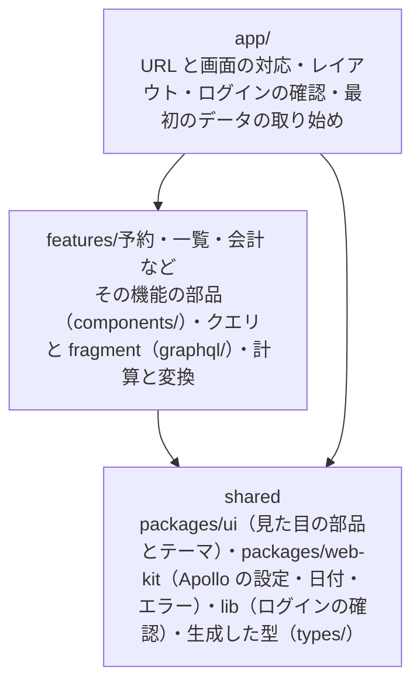

# フロントエンドの設計

Next.js（App Router）＋Chakra UI＋Apollo Client。進め方は [roadmap.md](roadmap.md) の 1章の冒頭と同じ（2026-11-17 から、最初からきちんとした設計で作る）。下の表の「起こす課題」は、先に防ぐものの一覧として読む。

## 1. アーキテクチャ（層と依存の向き）

バックエンドと同じく、**層と、依存の向き**で考える。



| 決まり | 理由 |
| --- | --- |
| 上から下へだけ import する（shared は features を知らない） | 見た目の部品が、業務の言葉（予約・会計）を持たない。どこでも使い回せる |
| features どうしは、直接 import しない。要るなら shared に下ろすか、app で組み合わせる | 予約の変更が、会計の画面を壊さない。消すときはフォルダごと消せる |
| 1つの機能の物（部品・fragment・mutation）は、1つのフォルダに置く。テストは `test/` に、同じ並びで置く | 画面が要る項目を、部品の近くで決められる（fragment colocation）。探す場所が1つ。テストは、本番のコードと混ざらず、まとめて見られる |
| データを取る部品と、props だけで描く部品を分ける。fragment を読む部品は、`useFragment` で読むだけの薄い部品と、読んだ値を props で受け取って描く `〜View` に分ける | 描く部品は Storybook に載り、VRT とテストの対象になる（Apollo Client がなくても描ける） |
| 決まりは、最初は文で書くだけ。破れるのを見てから、ESLint で止める（段階4） | なぜリンターで止めるのかを体験する |

### フォルダの形（3つのアプリで同じ。2026-11-23 から。[D-020](decisions.md)）

```
apps/<app>/
  app/                          ← URL と画面の対応だけ
  features/<機能>/
    graphql/<名前>.graphql       ← クエリ・mutation・fragment（GraphQL のまま書く）
    graphql/<名前>.generated.ts  ← pnpm codegen が作る（操作の型と、型付きのドキュメント。手で直さない）
    components/                 ← 部品（.tsx）
    <計算・変換>.ts              ← 画面を持たない処理
  lib/                          ← アプリ全体の設定（ログインの確認。そのクエリは lib/graphql/）
  types/__generated__/graphql.ts ← pnpm codegen が作る（enum と入力の型）
  types/apollo-client.d.ts      ← data masking の型を、codegen の型に合わせる
  test/                         ← テスト（features・lib と同じ並び）
```

- 型は GraphQL Code Generator の `near-operation-file-preset`＋`typescript-operations`＋`typed-document-node` で作る（Apollo Client のドキュメントがすすめる形）。enum は文字列の合併型、日時の scalar は `string`
- テストのファイルは、先頭にデータ（偽の応答・作る関数・モック・定数）、その下に `describe("正常系")`（期待どおりに進む流れ）と `describe("異常系")`（断られる・失敗する・境界・二重送信・ログイン切れ）

### fragment の中身の隠し方（Apollo Client の data masking）

`dataMasking: true`（`packages/web-kit/src/apollo.ts`）。クエリの結果からは、子の部品の fragment の中身が見えない。

| 場面 | 書き方 | 例 |
| --- | --- | --- |
| 子の部品が、自分の fragment を読む | 親は、受け取った値をそのまま渡す（型は `FragmentType<〜Fragment>`）。子が `useFragment({ fragment: 〜FragmentDoc, from })` で読み、`〜View` に渡す | 患者の `AppointmentCard`・事務の `AppointmentTable` の行・医師の `ScheduleItem` |
| 取った画面が、自分で fragment を読む（fragment は、mutation と同じ形を受け取るために分けている） | クエリの側で `...〜 @unmask` | 患者の `QuestionnairePage`・事務の `BillPage` |
| 子の部品の fragment の項目を、別の画面でも使いたい | 子の fragment を読まずに、その画面のクエリで項目を直接選ぶ | 医師の `AppointmentDetail`（患者の名前・時刻） |

### 描く場所の分け方（App Router）

| 場所 | 置くもの | 理由 |
| --- | --- | --- |
| サーバーの部品 | レイアウト・ログインの確認・最初の表示に要るデータの取り始め | ブラウザへ送る JavaScript が減る。最初の表示が速い |
| ブラウザの部品 | 操作のある所（フォーム・絞り込み・続きの読み込み）・Apollo Client のキャッシュを使う所・Chakra UI の部品 | 状態とイベントを持つ |

Apollo Client と Chakra UI は、ブラウザの側で動く部分が大きい。**どこに境界を引くと、何が速くなり、何が面倒になるか**を、段階2で測って記録する。Pages Router（ページごとに `getServerSideProps` で取る形）との違いも、ここで比べる。

### 状態の置き場（5種類に分ける）

| 種類 | 例 | 置き場 | よくある失敗 |
| --- | --- | --- | --- |
| サーバーの状態 | 予約・診療枠・会計 | Apollo Client のキャッシュ | サーバーのデータを `useState` に写して、ずれる |
| URL の状態 | 絞り込み・並び順・開いているタブ | URL のクエリ | `useState` で持って、リロード・共有・戻るで消える |
| フォームの状態 | 入力中の値・検証のエラー | React Hook Form＋Zod | 1文字ごとに画面全体が描き直される |
| 画面の中だけの状態 | モーダルの開閉・ホバー | その部品の `useState` | 何でも上の部品へ持ち上げる |
| アプリ全体の UI の状態 | ログイン中の人・通知（トースト） | Context（小さく） | 何でも全体の状態に入れ、どこからでも書き換わる |

別の状態管理の道具（Redux・Zustand など）は入れない。入れたくなったら、上の5つのどれが足りないのかを先に書く。

## 2. 6つのテーマ

バックエンドと同じ進め方（素朴に作る → 困ることを起こす → 測る → 入れる）で、6つを回す。F の番号は [requirements.md](requirements.md) の 11章。

| # | テーマ | 起こす課題 | 測り方 | 入れるもの | 段階 |
| --- | --- | --- | --- | --- | --- |
| F1 | 画面の表示速度 | 一覧に1,000行出すと重い。最初の表示が遅い。入力のたびに一覧が全部描き直される。送る JavaScript が大きい | Lighthouse・Web Vitals（LCP・INP・CLS）・React の Profiler・バンドルの分析 | 続きの読み込み（必要なら仮想化）・サーバーで先に描く・遅延読み込み・描き直しを減らす | 2・6 |
| F2 | API との通信 | 親と子の部品が順番に取りに行く（滝）。要らない項目まで取る。mutation のあと一覧が古い。ボタンを2回押すと2回送る | ブラウザのネットワークのタブ・Apollo の開発ツール | fragment で1回にまとめる・`fetchPolicy`・キャッシュの更新・楽観的な更新・エラーと再試行・読み込み中の見せ方 | 2・3・5 |
| F3 | 状態管理 | 絞り込みがリロードで消える。サーバーのデータを state に写してずれる | 画面を操作して再現する | 状態を5種類に分けて、置き場を決める（上の表） | 1・2・4 |
| F4 | コンポーネント設計 | 部品がデータの取得と見た目を両方持ち、Storybook に載らない。props が増え続ける。似た部品が増える | Story が書けるか・props の数 | 取る部品と描く部品を分ける・fragment を隣に置く・`packages/ui`・部品の組み合わせ（合成） | 1・4・6 |
| F5 | テスト | E2E だけだと遅くて不安定。部品のテストがモックだらけ。見た目の崩れに気づかない | CI の時間・理由なく落ちた回数・見逃した不具合 | 何をどの層で守るかを決める（下の表） | 1・3・6 |
| F6 | 開発効率 | 型を手で書く。ライブラリの更新が手作業でたまる。CI が遅い。PR で見た目が分からない | CI の時間・更新の件数・1つの画面を足す時間 | 型の自動生成・リンター・CI のキャッシュ・Storybook・Renovate・部品の雛形 | 0・6 |

### テストをどの層で守るか（F5）

| 層 | 道具 | 守るもの | 量 |
| --- | --- | --- | --- |
| 型・リンター | TypeScript・ESLint・生成した型 | スキーマとのずれ・書き間違い | 全部（自動） |
| 単体 | Vitest | 計算・変換・検証のルール（日付・金額・状態の判定） | 多い |
| 部品 | Testing Library＋MSW（GraphQL の応答を偽物にする） | 1つの機能の動き（入力 → 送る → 結果やエラーが出る） | 中くらい |
| 見た目 | Storybook＋Chromatic | 部品の見た目が、意図せず変わっていないこと | Story の数だけ |
| E2E | Playwright | 止まると困る流れだけ（ログイン → 予約 → キャンセル、支払い） | 少ない |

E2E は、大事な流れだけに絞る。**その判断を、ここでは「E2E だけで始めて、遅さと不安定さを数字で見てから下の層へ移す」順で確かめる**。
