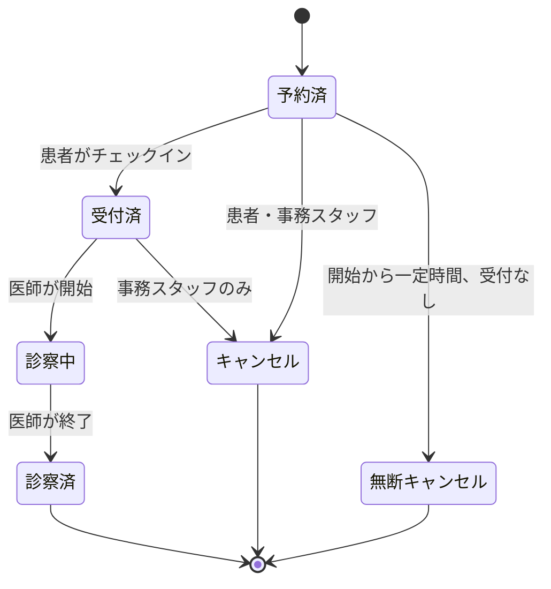
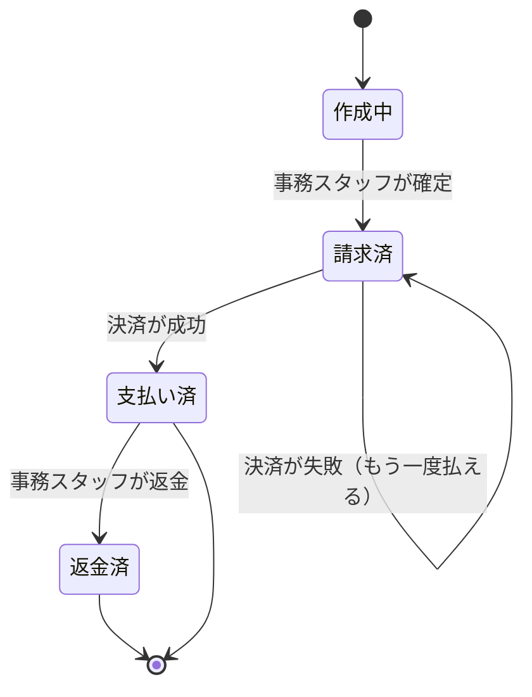
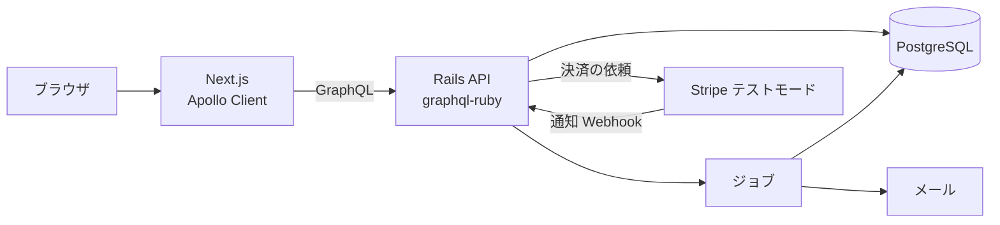

# 要件

何を作るかと、それで何を確かめるかを書く。どう作るか（テーブルの定義・GraphQL のスキーマ・層の中身）は、段階ごとに [decisions.md](decisions.md) と `docs/steps/` に書く。未決は 13章。

## 1. 目的と範囲

**目的**: よく使われる構成（Ruby on Rails＋GraphQL＋Next.js＋Apollo Client）で、架空のオンライン診療の「予約 → 受付 → 診察 → 会計」を自分で設計して作る。
バックエンドの設計（API・DB・SQL・トランザクション）と、アーキテクチャの判断を、**自分で確かめた事実**として説明できるようにする。

種類は「アウトプット（学習）」。公開して運用するサービスではない。

**この1本で確かめる3つ**

| 見られること | このアプリでの答えの作り方 | 書くところ |
| --- | --- | --- |
| アーキテクチャと設計 | 構成・層・トランザクションの境界を、比べた案と選んだ理由つきで決める | 10. アーキテクチャの方針・設計の記録（ADR） |
| どんな機能を作ったか | 設計の判断が要る機能だけを選ぶ（予約・一覧・権限・会計・通知） | 7. 機能の仕様 |
| どんな課題を改善したか | まず素朴に作る → 測る → 直す → 前と後の数字を残す | 11. 課題と改善の記録 |

**第1期（最初に通す）**
- 診療枠を作る・予約する・変更する・キャンセルする
- 医療機関の予約の一覧（絞り込み・並び替え・ページング）
- 患者・医師・事務スタッフの権限と、医療機関ごとのデータの分離

**第2期**
- 受付（チェックイン）から診察の終了まで
- 会計と決済（Stripe のテストモード）、返金
- 予約の前日のリマインド通知

**第3期**
- 事前問診
- 閲覧の監査ログ
- 医療機関のダッシュボード（日ごと・医師ごとの集計）
- 運用の土台（CI・ライブラリの自動更新・VRT・安全なマイグレーション・デプロイ）

**作らない**
- ビデオ通話（外部の SDK を組み込むだけで、設計の判断が少ない。診察は「開始」「終了」のボタンで代える）
- 処方・薬の配送、保険の計算、電子カルテ
- 患者向けのモバイルアプリ、多言語

---

## 2. 守ること

- **確かめたことの出どころを書く**。ここで分かったことは「個人開発で作って確かめた」こととして書く。測った条件を添える
- **実務を持ち込まない**。実務のコード・画面・仕様・名前・データは使わない。一般的なオンライン診療として、自分で考えて設計する
- **一気に作らない**。機能ごとに、設計の判断 → 実装 → 測る → 記録、の順で進める
- **判断を残す**。比べた案・選んだ理由・弱点を、機能ごとに短く書く（リポジトリの `docs/decisions.md`）

---

## 3. 用語

| 用語 | 意味 |
| --- | --- |
| 医療機関 | データを分ける単位（テナント）。スタッフと医師が所属する |
| 患者 | 予約して診察を受ける人。複数の医療機関を予約できる |
| 医師 | 診療枠を持ち、診察する人 |
| 事務スタッフ | 医療機関の予約と会計を管理する人 |
| 診療枠 | 医師 × 開始時刻 × 長さ。定員は1人 |
| 予約 | 患者が診療枠を1つ押さえたもの |
| 受付（チェックイン） | 予約の時刻の前に、患者が「準備できた」と伝えること |
| 診察 | 予約に対して行われた1回の診察の記録 |
| 会計 | 診察に対する請求。明細と合計を持つ |
| 支払い | 会計に対する、外部の決済サービスでの決済の1回の試み |

---

## 4. 登場人物と権限

| できること | 患者 | 医師 | 事務スタッフ |
| --- | --- | --- | --- |
| 診療枠を作る・閉じる | — | 自分の枠 | 自院の全員の枠 |
| 空いている枠を見る | ○ | ○ | ○ |
| 予約する・変更する・キャンセルする | 自分の予約 | — | 自院の予約 |
| 予約の一覧を見る | 自分の予約 | 自分が担当の予約 | 自院の全部 |
| 診察を始める・終える | — | 自分が担当の予約 | — |
| 会計を作る・確定する | — | — | 自院の会計 |
| 支払う | 自分の会計 | — | — |
| 返金する | — | — | 自院の会計 |
| 問診に答える・見る | 自分の分 | 自分が担当の分 | —（見えない） |
| 監査ログを見る | — | — | 自院の分（管理者のみ） |

**決まり**
- 権限は毎回サーバーで確かめる。画面でボタンを隠すだけにしない
- 他の医療機関・他の患者のデータは、ID を直接指定しても取れない。存在するかどうかも教えない（見つからない、として返す）
- 問診の中身は、事務スタッフには見せない（役割ごとに見える項目が違う例として作る）

---

## 5. ユースケース

### 患者
- U1. 医療機関と医師を選び、空いている枠から予約する
- U2. 予約の時刻を変える、キャンセルする
- U3. 予約の前に問診に答える
- U4. 当日、受付（チェックイン）をする
- U5. 診察のあと、会計を見て支払う
- U6. 前日にリマインドの通知を受け取る

### 医師
- U7. 自分の診療枠をまとめて作る（曜日と時間帯から）
- U8. 今日の予約の一覧を見て、問診を読む
- U9. 診察を始める・終える

### 事務スタッフ
- U10. 自院の予約の一覧を、日付・医師・状態で絞って見る
- U11. 電話で受けた予約を、患者の代わりに入れる
- U12. 診察が終わった予約の会計を作り、確定する
- U13. 返金する
- U14. 日ごと・医師ごとの件数と売上を見る

### 第1期で通すユースケース
U1・U2・U7・U10・U11（予約まわりと一覧と権限）。

---

## 6. 状態

状態は1つの列で持ち、どこからどこへ移れるかを決める。フラグの列（`is_canceled` など）を並べない。

### 予約

- 時刻の変更は、状態を変えずに枠を付け替える（予約済のときだけ）
- 患者がキャンセルできるのは、開始の1時間前まで（仮。13章の M6）
- 状態ごとの日時（受付した日時・開始した日時・終了した日時・キャンセルした日時）を残す

### 会計と支払い

- 支払い（決済の1回の試み）は、会計とは別に持つ。状態は「処理中 → 成功／失敗／不明」
- 「不明」は、外部の決済サービスがタイムアウトして、成功したか分からない状態。あとで照合して、成功か失敗に落ち着かせる

---

## 7. 機能の仕様

各機能に「確かめる設計のテーマ」を付ける。

### 7-1. 診療枠（第1期）

- 医師か事務スタッフが、曜日・時間帯・1枠の長さ・期間を指定して、枠をまとめて作る
- 同じ医師の同じ開始時刻の枠は、2つ作れない
- 予約が入っていない枠だけ閉じられる
- 確かめるテーマ: テーブル設計（主キー・型・タイムゾーン付きの日時）、UNIQUE、まとめて登録する SQL

### 7-2. 予約する・変更する・キャンセルする（第1期）

- 患者は、空いている枠を選んで予約する。1つの枠に入れる予約は1件
- 同じ枠に同時に予約が来たら、1件だけ成功し、ほかは「すでに埋まっています」と返す
- キャンセルした予約の枠は、もう一度予約できる
- 変更は、新しい枠を押さえることと、前の枠を空けることを、必ず一緒に行う（片方だけ成功しない）
- 事務スタッフは、患者の代わりに予約を入れられる。誰が入れたかを残す
- 確かめるテーマ: 同時更新、制約、状態の遷移、論理削除と UNIQUE、デッドロック

### 7-3. 予約の一覧（第1期）

- 事務スタッフは、自院の予約を、日付の範囲・医師・状態で絞り、開始時刻の順で見る
- 1行に、患者の名前・医師の名前・枠の時刻・状態・会計の状態を出す
- 続きは、スクロールで読み込む。途中で予約が増えても、同じ行が2回出ない・抜けない
- 医師は「今日の自分の予約」、患者は「自分のこれからの予約」と「過去の予約」を見る
- 確かめるテーマ: GraphQL の N+1、カーソルページング、複合インデックスと実行計画、JOIN

### 7-4. 権限と医療機関ごとの分離（第1期）

- 4. 登場人物と権限 の表のとおりに動く
- ログインは、メールアドレスとパスワード。患者とスタッフは別の入口
- 確かめるテーマ: 認証、認可と IDOR、マルチテナント

### 7-5. 受付から診察の終了まで（第2期）

- 患者は、開始の〔何分前から・未決〕受付できる
- 医師は、受付済の予約だけ診察を始められる
- 診察を終えると、会計の下書きが自動でできる
- 開始から〔何分・未決〕たっても受付がない予約は、定期の処理で「無断キャンセル」にする
- 確かめるテーマ: 状態の遷移を更新の条件に入れる、定期の処理と画面の操作がぶつかったとき

### 7-6. 会計と決済（第2期）

- 事務スタッフが明細（項目・単価・数量）を入れて確定する。確定したあとは変えられない
- 料金の表の値段を変えても、過去の会計の金額は変わらない
- 患者がカードで支払う。ボタンを2回押しても、通信が切れて送り直しても、課金は1回
- 決済サービスから同じ通知が2回来ても、順番が前後しても、結果は同じ
- 決済サービスが遅い・落ちているとき、予約や診察の画面は止まらない。支払いは「確認中」と出し、あとで結果が入る
- 返金は、支払い済の会計だけ。全額のみ
- 確かめるテーマ: 冪等性と外部 API の失敗、トランザクションの範囲、時点の値、金額の型

### 7-7. リマインド通知（第2期）

- 予約の前日の決まった時刻に、患者へメールを送る（開発ではメールを実際には送らず、送った内容を見られる仕組みで確かめる）
- キャンセルされた予約には送らない。同じ予約に2回送らない
- 予約が入ったとき・キャンセルされたときにも、確認のメールを送る。予約は入ったのにメールが出ない、を起こさない
- 確かめるテーマ: 非同期のジョブと再試行、outbox

### 7-8. 事前問診（第3期）

- 医療機関ごとに質問を決められる（文章・選択・複数選択）
- 患者は、途中まで保存して、あとで続きを書ける
- 入力のエラーは、どの質問のどこが悪いかを、まとめて返す
- 問診の答えは、DB の中で暗号にして持つ。ログに中身を出さない
- 確かめるテーマ: エラーの設計、JSON の列を使うか普通の表にするか、個人情報の扱い

### 7-9. 閲覧の監査ログ（第3期）

- 誰が・いつ・どの患者の・何を見たか、変えたかを残す。あとから変えられない・消せない
- 確かめるテーマ: 履歴の持ち方、書き込みが多い表のインデックス

### 7-10. ダッシュボード（第3期）

- 日ごと・医師ごとの、予約の件数・キャンセルの割合・売上を見る
- 確かめるテーマ: 集計の SQL、集計の表を前もって作るか

### 7-11. 運用の土台（第3期。ただし CI とテストは第1期から）

- CI で、テスト・リンター・型のチェックを回す
- ライブラリの更新は、自動で PR を作り、テストと VRT が通ったものだけ入れる
- 危ないマイグレーションは、CI で止める
- 確かめるテーマ: ライブラリの更新と品質の改善を、数字つきで確かめる。マイグレーション

---

## 8. データとトランザクションの要件

テーブルの定義は設計書で決める。ここでは、守らなければならないことだけを書く。

### DB の側で守ること

| # | 守ること | 手段の候補（設計書で比べて決める） |
| --- | --- | --- |
| R1 | 1つの枠に、有効な予約は1件まで | 部分 UNIQUE（キャンセルを除く）／枠の行をロック／枠の側に状態を持つ |
| R2 | 同じ医師の枠の時間は重ならない | UNIQUE（医師・開始時刻）／範囲の型と排他制約 |
| R3 | 予約の状態は、決めた遷移しかしない | CHECK＋更新の条件に今の状態を入れる |
| R4 | 会計の金額は、あとから変わらない | 明細に、その時の単価をコピーする |
| R5 | 1つの会計に、成功した支払いは1件まで | 部分 UNIQUE／冪等キーの UNIQUE |
| R6 | 金額は整数（円） | 整数の型 |
| R7 | すべての行は、どの医療機関のものかが分かる | 医療機関の ID を持つ／親をたどる |
| R8 | 日時はタイムゾーン付き | タイムゾーン付きの日時の型 |

### トランザクションの境界（1つにまとめるもの・分けるもの）

| 操作 | 1つのトランザクションに入れるもの | 外に出すもの | 説明できるようにする問い |
| --- | --- | --- | --- |
| 予約する | 枠が空いているかの確認、予約の作成、送るメールの記録（outbox） | メールの送信 | 同時に来たら？ 分離レベルは？ |
| 予約を変更する | 新しい枠を押さえる、前の枠を空ける | メールの送信 | 2つの行をロックする順番は？ デッドロックは？ |
| キャンセルする | 状態の変更、送るメールの記録 | メールの送信、返金の依頼 | 定期の処理と同時に来たら？ |
| 診察を終える | 状態の変更、会計の下書きの作成 | — | 2回押されたら？ |
| 支払う | 「処理中」の支払いを作ってコミット →（外部を呼ぶ）→ 結果の反映は別のトランザクション | 決済サービスの呼び出し | なぜ外に出す？ タイムアウトしたら？ |
| 決済の通知を受ける | 通知の記録（重複の確認）、支払いと会計の状態の変更 | — | 2回来たら？ 順番が前後したら？ |
| 無断キャンセルの処理 | 対象の予約の状態の変更（少しずつ） | — | 大量の更新は？ ロックは？ |

**決まり**: トランザクションの中で、外部のサービス（決済・メール）を呼ばない。

### SQL で書けるようにするもの

ORM に任せず、どんな SQL が出ているかを見て、必要なら自分で書く。

- 予約の一覧（予約・枠・医師・患者・会計の結合。絞り込みと並び替えとカーソル）
- 空いている枠の検索（予約のない枠。NOT EXISTS）
- 患者ごとの、最新の診察の1件（ウィンドウ関数など）
- 日ごと・医師ごとの集計（先に集計してから結合する）
- 枠をまとめて作る（1文でまとめて登録）
- 100万件の予約を入れて、インデックスの前と後を実行計画で比べる

---

## 9. API（GraphQL）の要件

スキーマの中身は設計書で決める。ここでは、守る決まりだけを書く。

- **スキーマを先に決める**。スキーマから、フロントエンドの型を自動で作る
- **一覧はカーソルで返す**（Relay の Connection の形）。件数の上限を決める
- **N+1 を出さない**。関連はまとめて読む。一覧のテストに、クエリの数の上限を入れる
- **エラーは2種類に分ける**。使う人が直せるもの（入力の誤り・すでに埋まっている・権限がない）は、mutation の結果の中に、コードと項目つきで返す。想定していないものは、中身を出さずに返す
- **二重に実行されて困る mutation は、冪等キーを受け取る**（支払い）
- **変えるときは壊さない**。項目は足す → 非推奨にする → 消す。壊す変更は CI で止める
- **重いクエリを止める**。深さと複雑さに上限を付ける
- **認可は、項目を取る所で確かめる**（どの層に置くかは設計書で決める）

### フロントエンド（Next.js＋Apollo Client）の要件

Apollo Client を、理由を言える形で使う。

- 型は、スキーマとクエリから自動で作る。画面の部品ごとに、要る項目を fragment で持つ
- mutation のあと、一覧をどう新しくするかを、操作ごとに決める（キャッシュを直接直す／取り直す）。決めた理由を残す
- 予約・キャンセルは、結果を待たずに画面を先に変えるか（楽観的な更新）を、失敗したときの見え方と合わせて決める
- 一覧の続きの読み込みは、カーソルで。キャッシュのつなぎ方を決める
- エラーは1か所で受ける（ログインが切れた・権限がない・通信の失敗）
- サーバーで描く画面と、ブラウザで描く画面の分け方を決める（Router は App Router。13章の M3）

---

## 10. アーキテクチャの方針

### 構成（案）

| 部分 | 案 | 選ぶ理由 | 比べるもの（記録に残す） |
| --- | --- | --- | --- |
| バックエンド | Rails（API モード）＋graphql-ruby | 手本にする構成と同じ。一から組んで理解する | — |
| DB | PostgreSQL | 実行計画・ロックの道具がそろっている。手本にする構成と同じ | MySQL |
| フロントエンド | Next.js＋Apollo Client＋型の自動生成 | 手本にする構成と同じ | urql・TanStack Query |
| ジョブ | Solid Queue（13章の M4） | DB だけで動き、登録とジョブを同じトランザクションに入れられる | Sidekiq（Redis が要る）・Delayed::Job |
| 決済 | Stripe のテストモード | 本物の通知・失敗・タイムアウトを試せる | 自分で偽物のサーバーを作る |
| 認証 | Cookie のセッション | すぐ無効にできる。ブラウザだけが相手 | トークン（JWT） |

### 層の分け方（方針）

- **入口**（GraphQL の resolver・mutation）: 入力を受けて、認可を確かめ、業務の処理を呼び、結果を形にして返す。業務のルールを書かない
- **業務の処理**（1つの操作 = 1つのクラス）: 状態の遷移・トランザクションの範囲・外部の呼び出しの順番を、ここに書く
- **モデル**（ActiveRecord）: 関連・検証・絞り込みの名前。重い業務の処理を持たせない
- **複雑な読み取り**（一覧・集計）: 専用のクエリのクラスに分ける。必要なら SQL を書く

決めること: どこまで分けるか。Rails の標準（モデルに寄せる）から始めて、困った所で分けるか、最初から分けるか。**どちらを選んでも、理由と弱点を言えるようにする**（「理想の設計は？」に、今の問題 → どう分けるか → 何から始めるか、で答える材料になる）。

### 設計の記録（ADR）

判断ごとに、リポジトリの `docs/decisions.md` へ短く書く。形は、**困ったこと → 比べた案 → 選んだもの → 理由 → 弱点・やめる条件**。
最低限、次の判断は記録する。

- 二重予約をどう防ぐか（R1 の3つの案）
- 層をどう分けるか
- GraphQL のエラーをどう返すか
- 認可をどの層に置くか
- 支払いのトランザクションをどこで切るか
- ジョブの道具をどれにするか
- mutation のあとのキャッシュをどう新しくするか

---

## 11. 課題と改善の記録

> **2026-11-17 に変更**（[decisions.md](decisions.md) の D-002）。素朴な作りを先に動かす順番は取らず、下の課題は**最初から防ぐ**。「残す数字」の前と後は取らず、守れていることをテストで確かめる。下の表は、防ぐものの一覧として読む。

「どんな課題を改善したか」に答えるために、**先に素朴な作りで動かし、測って、直す**。前と後の数字を残す。
素朴な作りは、わざと下手に書くのではなく、「最初に普通に書くとこうなる」形にする。

| # | 課題（素朴な作りで起きること） | 測り方 | 直し方 | 残す数字 | 時期 |
| --- | --- | --- | --- | --- | --- |
| K1 | 同じ枠に、同時に2件の予約が入る | 同時に20リクエストを送るテスト | DB の制約・ロック（R1 の案を比べる） | 成功の件数（20件中） | 第1期 |
| K2 | 予約の一覧で、クエリが行の数だけ出る | クエリのログ・N+1 の検知 | まとめて読む（dataloader） | クエリの本数・応答の時間 | 第1期 |
| K3 | 予約が100万件になると、一覧が遅い | 実行計画（`EXPLAIN (ANALYZE, BUFFERS)`） | 複合インデックス | 読んだ行・時間 | 第1期 |
| K4 | 深いページが遅い。途中で増えると、同じ行が2回出る | 実行計画・予約を足しながら送るテスト | OFFSET からカーソルへ | 深いページの時間・重複の有無 | 第1期 |
| K5 | ID を変えると、他院の予約が取れる | 他院の ID で取るテスト | 認可を1か所にまとめ、すべての項目で確かめる | テストの件数 | 第1期 |
| K6 | 予約の変更が同時に来ると、デッドロックする | 逆向きの変更を同時に送るテスト・エラーのログ | ロックの順番をそろえる・再試行 | エラーの件数 | 第1期 |
| K7 | 支払いを2回押すと、2回課金される | 同じ操作を同時に送るテスト | 冪等キー | 課金の件数 | 第2期 |
| K8 | 決済が遅いと、DB の接続を持ち続けて、ほかの画面も遅くなる | 偽物の遅いサーバー・接続の数を見る | 外部の呼び出しをトランザクションの外へ | 接続の数・ほかの API の時間 | 第2期 |
| K9 | 同じ通知が2回来ると、状態が壊れる | 同じ通知を2回送るテスト | 通知の ID の UNIQUE・状態の条件 | — | 第2期 |
| K10 | 予約は入ったのに、メールが出ないことがある | 登録の直後に処理を落とすテスト | outbox | — | 第2期 |
| K11 | ダッシュボードが、データが増えるほど遅い | 実行計画 | 集計の表 | 時間 | 第3期 |
| K12 | ライブラリの更新が、手作業で怖い | 更新にかかる時間・見逃した差分 | 自動の PR＋テスト＋VRT | 更新の件数・検知した差分 | 第3期 |
| K13 | 大きな表への列の追加で、画面が止まる | マイグレーション中に画面を動かす | 止めずに変える手順・リンター | 止まった時間 | 第3期 |

### フロントエンドの課題

| # | 課題（素朴な作りで起きること） | 測り方 | 直し方 | 残す数字 | 時期 |
| --- | --- | --- | --- | --- | --- |
| F1 | 一覧に1,000行出すと重い。最初の表示が遅い。送る JavaScript が大きい | Lighthouse・Web Vitals・React の Profiler・バンドルの分析 | 続きの読み込み・サーバーで先に描く・遅延読み込み・描き直しを減らす | LCP・INP・JavaScript の大きさ | 第1期・第3期 |
| F2 | 親と子の部品が順番に取りに行く。mutation のあと一覧が古い。ボタンを2回押すと2回送る | ネットワークのタブ・Apollo の開発ツール | fragment で1回にまとめる・キャッシュの更新・楽観的な更新・二重送信の防止 | リクエストの本数・操作から表示までの時間 | 第1期・第2期 |
| F3 | 絞り込みがリロードで消える。サーバーのデータを state に写してずれる | 画面を操作して再現する | 状態を5種類に分けて、置き場を決める | — | 第1期 |
| F4 | 部品がデータの取得と見た目を両方持ち、Storybook に載らない。props が増え続ける | Story が書けるか・props の数 | 取る部品と描く部品を分ける・共通の部品を `packages/ui` へ | Story の数 | 第1期・第3期 |
| F5 | E2E だけだと遅くて不安定。見た目の崩れに気づかない | CI の時間・理由なく落ちた回数 | 何をどの層で守るかを決める（型・単体・部品・見た目・E2E） | CI の時間・落ちた回数・層ごとのテストの数 | 第1期・第3期 |
| F6 | 型を手で書く。ライブラリの更新が手作業でたまる。CI が遅い | CI の時間・更新の件数 | 型の自動生成・CI のキャッシュ・自動の更新 | CI の時間・更新の件数 | 第3期 |

**記録の形**（1件ごとに、リポジトリの `docs/improvements/` に1ファイル）
1. 症状（何が起きたか）
2. 測った（どのツールで、何を見たか）
3. 原因
4. 直した（比べた案と、選んだ理由）
5. 数字（前と後）
6. 再発防止（テスト・CI に何を置いたか）

---

## 12. 非機能と完成の基準

### 非機能

- 予約の一覧は、予約が100万件・1つの医療機関に10万件あっても、〔200ms・仮〕以内
- テスト: 業務の処理・権限・同時のリクエストは、実際の DB で確かめる。画面は、予約の一連の流れを E2E で1本
- 秘密の値（決済のキーなど）を、コード・ログ・テストの出力に出さない。テストは偽の値で動かす
- 個人情報（名前・問診）を、ログに出さない
- 手元は Docker で、コマンド1つで立ち上がる。テスト用のデータ（100万件）を入れるコマンドがある

### 各期の完成の基準

- その期のユースケースが、画面から通る
- その期の課題（K の番号）に、前と後の数字つきの記録がある
- その期の判断が、設計の記録（ADR）にある
- 各テーマを1分で話せて、深掘りの4方向（なぜ／ほかの方法は／弱点は／問題が起きたら）に答えられる

---

## 13. 未決事項

| # | 決めること | 今の案 | 決める材料 |
| --- | --- | --- | --- |
| M1 | 名前 | **clinic-architecture に決定**（2026-11-17） | フォルダの名前を clinic-study から変えた |
| M2 | DB | **PostgreSQL に決定**（2026-11-17） | 手本にする構成と同じ |
| M3 | Next.js の Router | **App Router に決定**（2026-11-17） | 手本にする構成は Pages Router。2つを比べる |
| M4 | ジョブの道具 | **Solid Queue に決定**（2026-11-17） | 手本にする構成は Delayed::Job。どちらも DB に置く形なので、比べる |
| M5 | 認可の道具 | **ポリシーのクラスを自分で書く＋graphql-ruby の `authorized?` に決定**（2026-11-18。[decisions.md](decisions.md) の D-006） | graphql-ruby の仕組みだけ／Pundit などを足す |
| M6 | 患者がキャンセルできる期限・受付できる時間・無断キャンセルにする時間 | キャンセルの期限だけ**仮に「患者は、開始の1時間前まで」**で実装（2026-11-17。事務スタッフは、開始の時刻まで）。受付は**仮に「開始の30分前から、開始の15分後まで」**、無断キャンセルは**仮に「開始から15分」**（2026-11-18。`Appointments::ConsultationRule`） | 仕様として決めるだけ。仮の値は1か所の定数（`Appointments::CancellationRule::PATIENT_DEADLINE`）に置き、決まったら直す |
| M7 | デプロイ先 | 〔未決〕 | AWS に置くか。お金と手間との引き換え |
| M9 | リポジトリの置き場 | **`~/Desktop/personal-development/アウトプット/db-design/clinic-architecture/` に作成済み**（2026-11-17） | — |
