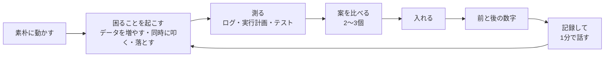
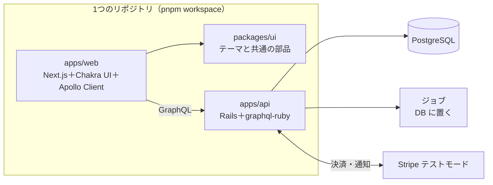

# 技術の選定と進め方

何を選ぶか・どの順で作るか・なぜそれを入れるのかを書く。何を作るかは [requirements.md](requirements.md)、フロントエンドの設計は [frontend.md](frontend.md)。

「手本」の列は、手本にする構成（Rails＋GraphQL＋Next.js で作られた、一般的な Web サービス）で、よく使われるもの。

## 1. 進め方の考え方

> **2026-11-17 に変更**（[decisions.md](decisions.md) の D-002）。**最初から、きちんとした設計で作る**。下の「素朴に動かす → 困ることを起こす → 測る → 入れる」の順番は取らない。
>
> - 4章の「わざと後回しにする」は、やめた。制約・N+1 の対策・インデックス・カーソル・認可・層の分割・エラーの設計は、その機能を作るときに一緒に入れる
> - 5章の段階は、「機能を足す順番」としてだけ使う。まず段階1（機能は、ログイン・診療枠・予約・キャンセル・予約の一覧）までを、止まらずに作る。段階2〜4の「入れるもの」のうち、段階1の機能に関わるものは、段階1で入れる
> - 「前と後の数字」は取らない。代わりに、守れていることをテストで確かめる（同時に20リクエストで成功は1件・一覧のクエリの本数の上限・他院の ID で取れない）
> - 100万件での実行計画の確認（K3・K4）は、まだしていない。段階1が終わってから、進め方と一緒に決める
>
> この章から下の、素朴に作る前提の文は、前の進め方の記録として残している。

**先に素朴なプロトタイプを動かす。そのあと、機能を足しながら「困ること」を1つずつ起こし、測って、道具や設計を入れる。**

こうする理由は3つ。

- **なぜ入れるのかが、体験として残る**。最初から全部入れると、「入れなかったら何が起きるか」を見ないまま進む。深掘り（なぜ／ほかの方法は／弱点は／問題が起きたら）に答えられるのは、入れる前の状態を見たものだけ
- **「どんな課題を改善したか」の材料になる**。前と後の数字が、そのまま話になる
- **「理想の設計は？」に答えられる**。素朴な作りが太っていく所を自分で見て、どこから分けたかを話せる

守ること: [product.md](product.md) の「守ること」。

---

## 2. 技術スタックの選定

「手本」の列は、公開されている記事から分かる、よくある組み合わせ。

### 土台（最初から入れる）

| 部分 | 手本 | 今回選ぶもの | 選ぶ理由 | 比べられること |
| --- | --- | --- | --- | --- |
| バックエンド | Ruby on Rails（1つのモノリス） | Rails（API モード） | 一から組んで理解する | モノリスと分割。なぜ最初はモノリスか |
| API | graphql-ruby | graphql-ruby | 同じ | REST との違い。GraphQL が向く場面・向かない場面（キャッシュ・エラー・N+1） |
| DB | PostgreSQL | PostgreSQL | 同じ。実行計画・ロックの道具がそろっている | MySQL との違い（部分インデックス・排他制約など） |
| フロントエンド | Next.js（Pages Router） | Next.js（App Router） | 今の標準で作り、手本の形と比べる | Pages Router（`getServerSideProps`）と App Router（サーバーの部品）で、データの取り方と描く場所がどう変わるか |
| UI | Chakra UI（2系） | Chakra UI（今の最新） | 同じ道具の今の形を知る | 2系と今の版の違い。大きな更新をどう安全に進めるか。MUI・Tailwind との違い |
| テスト（フロント） | Jest・Playwright・Storybook | Vitest＋Testing Library＋MSW・Playwright・Storybook | 「何をどの層で守るか」まで説明できるようにする | Jest と Vitest。部品のテストと E2E の分け方 |
| GraphQL クライアント | Apollo Client＋GraphQL Code Generator | 同じ | 使っていたものを、キャッシュの仕組みまで説明できるようにする | urql・TanStack Query との違い |
| パッケージ管理 | pnpm（workspace のモノレポ） | pnpm workspace | 同じ | npm・yarn との違い（厳密な依存の解決） |
| テスト（バック） | RSpec＋FactoryBot | 同じ | 同じ | resolver を直接呼ぶテストと、スキーマを通すテストの使い分け |
| CI | GitHub Actions | 同じ | 同じ | — |
| 手元の環境 | — | Docker Compose | コマンド1つで立ち上がる | — |

### 困ってから入れる（入れるきっかけつき）

| 入れるもの | 手本 | 今回 | 入れるきっかけ（先に起こすこと） | 段階 |
| --- | --- | --- | --- | --- |
| N+1 の検知 | Bullet | Bullet | 一覧のクエリのログに、同じ形が並ぶ | 2 |
| まとめて読む仕組み | GraphQL::Batch | graphql-ruby 標準の Dataloader（GraphQL::Batch と比べる） | 同上。クエリが行の数だけ出る | 2 |
| 複合インデックス | — | 実行計画を見て張る | 100万件で一覧が遅い | 2 |
| カーソルページング | — | Relay の Connection | 深いページが遅い・同じ行が2回出る | 2 |
| DB の制約・ロック | — | 部分 UNIQUE など（案を比べる） | 同時に20リクエストで、二重予約が入る | 3 |
| 業務の処理のクラス（service） | — | 1つの操作 = 1クラス | mutation が太り、テストが書きにくくなる | 4 |
| 認可の仕組み | — | 〔8章で決める〕 | ID を変えると、他院のデータが取れる | 4 |
| エラーの設計 | `extensions` に `code` と `detailed_code` | 同じ考え方で自分で作る | 画面で、エラーの種類を見分けられない。エラー率が測れない | 4 |
| 非同期のジョブ | Delayed::Job | Solid Queue（Delayed::Job・Sidekiq と比べる） | メールの送信で、予約の応答が遅い・失敗すると予約ごと失敗する | 5 |
| 決済 | 〔不明〕 | Stripe のテストモード | — | 5 |
| 冪等キー・outbox | — | 自分で作る | 二重課金・メールが出ない、を再現する | 5 |
| 安全なマイグレーション | 段階を分けたリリース（`ignored_columns`） | strong_migrations＋同じ手順 | 大きな表への変更で、画面が止まる | 6 |
| モジュールの境界 | Packwerk・Sorbet | Packwerk（Sorbet は入れない） | 予約・会計・通知が、互いの中を直接さわり始める | 6 |
| エラーの監視 | Sentry・Datadog・CloudWatch | Sentry（無料の枠） | 手元で気づけないエラーを見たい | 6 |
| 部品のカタログと VRT | Storybook＋Chromatic | Storybook＋Chromatic（reg-suit と比べる） | ライブラリを上げたら、見た目が崩れた | 6 |
| ライブラリの自動更新 | — | Renovate | 更新が手作業でたまる | 6 |
| 本番の置き場 | AWS ECS（Fargate）・Terraform | 同じ形を、短い期間だけ立てる | — | 7 |

**入れないもの**: Sorbet（型の学習は TypeScript 側で足りる。Ruby の型まで広げると焦点がぼける）、Kubernetes、React Native、ビデオ通話。

### 選定で話せるようにする4つの比較

手本にする構成と、今選ぶものが違う所。**違いを自分で確かめると、「そう決まっていたから」で止まらずに、理由を説明できる**。

1. **GraphQL::Batch と Dataloader**: どちらも「同じ種類の読み込みをためて、1回にまとめる」。仕組み（Promise か Fiber か）と、書き方の違いを、両方で同じ一覧を作って比べる
2. **Delayed::Job・Solid Queue と Sidekiq**: 前の2つは DB にジョブを置く。Sidekiq は Redis に置く。**DB に置くと、予約の登録とジョブの登録を1つのトランザクションに入れられる**（outbox と同じ効果）。引き換えは、DB の負荷と速さ
3. **Chromatic と reg-suit**: 部品ごとに撮るか、画面ごとに撮るか。お金・速さ・レビューのしやすさ
4. **Pages Router と App Router**: 手本は Pages Router。同じ画面（予約の一覧）を、ページごとにサーバーで取る形と、サーバーの部品で取る形で比べる

---

## 3. アーキテクチャの選定

### 全体の形

| 判断 | 選ぶもの | 理由 | やめる・変える条件 |
| --- | --- | --- | --- |
| バックエンドの形 | 1つの Rails（モノリス） | 1人で作る。トランザクションを1つの DB で完結できる。手本も同じ | チームと機能が増え、デプロイがぶつかるようになったら、まずモノリスの中を区切る（Packwerk） |
| フロントとバックの分け方 | 別のアプリ（Next.js と Rails API） | 手本と同じ。スキーマが境界になる | — |
| リポジトリ | 1つ（`apps/` と `packages/`） | スキーマの変更と画面の変更を、1つの PR で出せる | — |
| API の形 | GraphQL だけ（決済の通知の受け口だけ REST） | 画面ごとに要る項目が違う。型を自動で作れる | 外部に公開する API が要るなら REST を足す |
| 型の流れ | Rails がスキーマを出す → CI でずれを検査 → フロントの型を自動で作る | フロントとバックのずれを、実行する前に見つける | — |
| ジョブ | DB に置く | 登録とジョブを同じトランザクションに入れられる。Redis が要らない | ジョブの量で DB が苦しくなったら Redis へ |
| 認証 | Cookie のセッション | すぐ無効にできる。相手はブラウザだけ | アプリや外部のクライアントが増えたらトークン |

### バックエンドの層（段階で育てる）

最初から層を全部作らない。太ってきた所を見てから分ける。

| 段階 | 形 | そのとき起きること |
| --- | --- | --- |
| 1（プロトタイプ） | mutation の中に処理を書く。モデルは関連と検証 | 速く動く。まだ困らない |
| 3 | mutation の中に、トランザクション・ロック・状態の確認が入る | mutation が長くなる。同じ確認が2か所に出る |
| 4 | **業務の処理を1操作1クラスに出す**。mutation は、入力 → 認可 → 呼ぶ → 結果を形にする、だけ | テストが、GraphQL を通さずに書ける。認可の場所が決まる |
| 4 | **複雑な読み取りをクエリのクラスに出す** | 一覧の SQL を1か所で見られる |
| 6 | **モジュールに区切る**（予約・会計・通知）。Packwerk で、互いの中を直接さわるのを止める | 「会計が予約のテーブルを直接書き換える」を CI で止められる |

この順番そのものが、「時間があったら理想の設計は？」の答えになる（今の問題 → どう分けるか → 何から始めるか）。

### フロントエンド

層と依存の向き・描く場所の分け方・状態の置き場・6つのテーマ・テストの層は、[frontend.md](frontend.md) に書く。

---

## 4. 最初から入れるもの・あとから入れるもの

「あとから入れると理由が体験できるもの」だけを後回しにする。「あとから入れても手戻りになるだけのもの」は最初に入れる。

| 最初から入れる | 理由 |
| --- | --- |
| テスト（RSpec・最小の画面のテスト）と CI | あとの段階は、全部「再現するテストを書く」から始まる |
| スキーマから型を作る流れ | あとから入れると、全部の画面を書き直す |
| 主キー・型・NOT NULL・外部キー・タイムゾーン付きの日時 | テーブルの基本。あとから直すのはマイグレーションの練習にはなるが、段階6まで待てない |
| 医療機関の ID を持つ列 | あとから全部の表に足すのは重い |
| 秘密の値をコードとログに出さない設定 | 守るもの。学習の題材にしない |
| リンター・フォーマッター | — |

下の表の「わざと後回しにする」は、2026-11-17 にやめた（1章の冒頭）。ジョブ・outbox だけは、メールを送る機能（段階5）と一緒に入れる。

| わざと後回しにする（やめた） | そのあいだ起きること（＝課題の材料） |
| --- | --- |
| 二重予約を防ぐ制約 | 同時に来ると2件入る（K1） |
| N+1 の対策・インデックス・カーソル | データが増えると遅い（K2〜K4） |
| 認可のまとめ | 他院のデータが取れる（K5） |
| 層の分割 | mutation が太る |
| ジョブ・outbox | メールで応答が遅い・片方だけ成功する（K10） |
| エラーの設計 | 画面でエラーを見分けられない |

K の番号は [requirements.md](requirements.md) の 11章。

---

## 5. 段階（ロードマップ）

1つの段階は、**機能を足す → 困ることを起こす → 測る → 入れる → 記録する**。期間は目安（平日の夜と週末で進める前提）。

### 一覧

| 段階 | 名前 | 足す機能 | 起こす課題 | 入れるもの | 目安 |
| --- | --- | --- | --- | --- | --- |
| 0 | 土台 | 「こんにちは」が、DB → GraphQL → 型 → 画面まで通る | — | 2章の土台。フロントの層のフォルダ（F6） | 2〜3日 |
| 1 | プロトタイプ | ログイン・診療枠・予約・キャンセル・予約の一覧 | —（F3・F4・F5 の素朴な形を作る。テストは E2E を1本だけ） | テーブルの初版 | 1週 |
| 2 | データを増やす | 一覧の絞り込み・並び替え・続きの読み込み | K2・K3・K4／F1・F2・F3 | Bullet・Dataloader・複合インデックス・カーソル／fragment でまとめる・URL の状態・サーバーで先に描く | 1〜2週 |
| 3 | 同時に叩く | 予約の変更・事務スタッフの代理の予約・状態の遷移 | K1・K6／F2・F5 | 制約・ロック・トランザクションの見直し／キャッシュの更新・楽観的な更新・部品のテスト（MSW） | 1週 |
| 4 | 権限とエラー | 3つの役割・医療機関ごとの分離 | K5／F3・F4 | 認可・エラーの設計・層の分割／エラーを1か所で受ける・層の決まりを ESLint で止める・取る部品と描く部品を分ける | 1週 |
| 5 | 会計・決済・通知 | 受付〜診察・会計・支払い・返金・リマインド | K7〜K10／F2 | ジョブ・冪等キー・outbox・Stripe／「確認中」の見せ方・二重送信の防止 | 2週 |
| 6 | 運用 | （機能は足さない） | K12・K13／F1・F5・F6 | strong_migrations・Packwerk・Sentry／Storybook＋Chromatic・Renovate・CI のキャッシュ・バンドルの見直し | 1〜2週 |
| 7 | 本番に置く | — | — | AWS ECS（Fargate）・RDS・Terraform | 1週 |
| 8 | 余裕があれば | 問診・監査ログ・ダッシュボード | K11 | 暗号化・集計の表 | — |

**段階3までを先に終える**。DB・トランザクション（K1〜K4・K6）と、フロントの表示速度・通信・状態（F1〜F3）が、ここまでで一通り出る。

### 段階ごとの「理解すること」

各段階の終わりに、下の問いに1分で答えられるようにする。

#### 段階0. 土台

- バック: Rails の API モードは、普通の Rails と何が違うか。GraphQL のリクエストは、Rails の中をどう流れるか（ルート → コントローラー → スキーマ → resolver）
- フロント: スキーマから型ができる流れ。Apollo Client は、どこでサーバーとつながるか
- 運用: CI は何を確かめているか

#### 段階1. プロトタイプ

- バック: テーブルをなぜその形にしたか（主キー・型・NOT NULL・外部キー）。予約の状態を、なぜ1つの列にしたか。query と mutation の違い
- フロント: 一覧と詳細で、同じ予約がキャッシュの中でどう持たれるか（正規化）。mutation のあと、一覧はなぜ変わる・変わらないのか
- 記録: テーブル設計の初版と理由（ADR の1件目）、ER 図

#### 段階2. データを増やす

- 準備: 予約を100万件入れるコマンドを作る
- バック: N+1 は、GraphQL でなぜ起きやすいか。Dataloader は何をしているか。複合インデックスの列の順番を、どう決めたか。実行計画のどこを見たか。OFFSET とカーソルの違い。並び順が重複するとき、どうするか
- フロント: 続きの読み込みで、キャッシュをどうつなぐか。絞り込みを変えたとき、前の一覧はどうなるか。絞り込みを、なぜ URL に置くのか。親と子が順番に取りに行く「滝」を、どう1回にまとめたか。サーバーで先に描くと、何が速くなり、何が面倒になるか。LCP・INP・CLS は、それぞれ何を測っているか
- 残す数字: クエリの本数、一覧の時間（インデックスの前と後）、深いページの時間（OFFSET とカーソル）、リクエストの本数、LCP と INP（前と後）、送る JavaScript の大きさ
- 比べる: GraphQL::Batch と Dataloader。Pages Router の取り方と App Router の取り方

#### 段階3. 同時に叩く

- 準備: 同時に20リクエストを送るテストの書き方
- バック: 「確かめてから登録する」が、なぜ破れるか。UNIQUE・条件付きの更新・`FOR UPDATE` を、どう使い分けるか。分離レベルの既定値と、それで防げること・防げないこと。予約の変更で、なぜデッドロックが起きるか。トランザクションに何を入れ、何を出すか
- フロント: 「すでに埋まっています」を、画面でどう出すか。先に画面を変える（楽観的な更新）と、失敗したとき何が起きるか
- 残す数字: 20件中の成功の件数（対策の前と後、案ごと）、デッドロックの件数
- 記録: 二重予約の防ぎ方の比較（ADR。**一番大事な1件**）

#### 段階4. 権限とエラー

- バック: 認証と認可の違い。認可をどの層に置いたか、なぜか。他院の ID を入れられたら、何を返すか。エラーを、mutation の結果に入れるものと、`errors` に入れるものに、どう分けたか。mutation から業務の処理を出したら、何が楽になったか
- フロント: エラーを1か所で受ける仕組み。役割で画面を出し分けるとき、画面だけで隠してはいけない理由
- 残す数字: 「他院のデータが取れない」テストの件数
- 記録: 認可の置き場所・エラーの設計・層の分け方（ADR）

#### 段階5. 会計・決済・通知

- バック: なぜ外部の呼び出しを、トランザクションの外に出すのか。タイムアウトは、なぜ「失敗」ではないのか。冪等キーの仕組み。同じ通知が2回来る・順番が前後するとき、どう守るか。ジョブを DB に置くことと、Redis に置くことの違い。outbox は、何を解決するか
- フロント: 「確認中」の状態を、画面でどう見せて、どう新しくするか。ボタンの二重押しを、画面とサーバーの両方で防ぐ理由
- 残す数字: 同じ操作を同時に送ったときの課金の件数、決済が遅いときの DB の接続の数
- 比べる: Delayed::Job・Solid Queue・Sidekiq

#### 段階6. 運用

- バック: 100万件の表に列を足す・名前を変える・列を消すとき、どの順番で出すか（足す → 両方に書く → 参照を切り替える → `ignored_columns` → 消す）。Packwerk は、何を止めるのか。エラー率を、GraphQL でどう測るか（全部 200 で返る問題）
- フロント: ライブラリの大きな更新を、どう安全に進めるか（更新の前と後で、数字を取る）。VRT は、何を守り、何を守れないか。テストを、どの層にどれだけ置くか。E2E を、なぜ大事な流れだけに絞るのか。CI は、どこに時間がかかっていて、何で縮めたか
- 残す数字: マイグレーション中に画面が止まった時間、CI の時間（前と後）、E2E が理由なく落ちた回数、自動の更新の件数、VRT が検知した差分の件数
- 比べる: Chromatic と reg-suit。Jest と Vitest

#### 段階7. 本番に置く

- 理解すること: リクエストが、ブラウザからコンテナと DB まで、どこを通るか（DNS・ロードバランサー・コンテナ・DB）。秘密の値を、どこに置くか。デプロイのとき、止めずに入れ替える仕組み。DB のマイグレーションを、いつ流すか
- 注意: お金がかかる。構成を Terraform に書き、確かめたら壊す。壊す前に、構成の図と、かかったお金を記録する

---

## 6. 1つの段階の回し方

解説を読んで、自分の言葉で答えてから実装する。**一気に作らない**。

| 順 | やること | できるもの |
| --- | --- | --- |
| 1 | 機能を足す（素朴に） | 動く画面 |
| 2 | 困ることを起こす（データを増やす・同時に叩く・落とす）。**再現するテストを先に書く** | 落ちるテスト・遅い数字 |
| 3 | 測る（クエリのログ・実行計画・接続の数） | 「前」の数字 |
| 4 | 実装の前に、解説を読む（[explain-step](../agents/skills/explain-step/SKILL.md)）。案を2〜3個比べる | 解説のページ・図 |
| 5 | 6つの問いに、自分の言葉で答える | 自分の答え |
| 6 | 設計の記録を書く（困ったこと → 比べた案 → 選んだもの → 理由 → 弱点） | `docs/decisions.md` |
| 7 | 実装する（AI が書く・テストを先に） | 通るテスト |
| 8 | もう一度測る | 「後」の数字 |
| 9 | 書いたコードの解説を読む（[explain-change](../agents/skills/explain-change/SKILL.md)） | 解説のページ |
| 10 | 課題と改善の記録を書く（6項目） | `docs/improvements/` |
| 11 | 声に出して、1分で説明する | 自分の言葉の説明 |

**6つの問い**: なぜそうするのか／ほかの方法は／弱点は／問題が起きたら／データが10倍・100倍になったら／手本にする構成ではどうなっていそうか（分からなければ「分からない」と書く）

**AI に書かせるときの決まり**: 5（自分の答え）を書く前に、7（実装）へ進まない。AI が書いたコードを、自分で説明できない所が残ったら、その段階は終わりにしない。

---

## 7. 残すもの

| 置き場 | 中身 |
| --- | --- |
| `README.md` | 何を作ったか・構成の図・確かめたことの一覧（数字つき） |
| `docs/decisions.md` | 設計の記録（困ったこと → 比べた案 → 選んだもの → 理由 → 弱点） |
| `docs/improvements/` | 課題と改善（1件1ファイル・前と後の数字） |
| `docs/steps/` | 段階ごとの解説と、6つの問いへの自分の答え |

人に説明するときは、ここで確かめたことを「個人開発で、一から作って、◯◯を確かめた」と、測った条件つきで言う。

---

## 8. 決めること

| # | 決めること | 案 | 決め方 |
| --- | --- | --- | --- |
| 1 | Next.js の Router | **App Router に決定**（2026-11-17） | 手本は Pages Router。道具は最新でよい、との判断。2つの違いを比べる |
| 2 | Chakra UI のバージョン | **今の最新に決定**（2026-11-17） | 手本は2系。今の版との違いを記録に残す |
| 3 | 認可の道具 | graphql-ruby の仕組み＋ポリシーのクラスを自分で書く | 段階4で、案を比べて決める |
| 4 | 手本の列の空欄 | 空のままでよい | 分からない所は「分からない」と書き、断言しない |
| 5 | 名前 | **clinic-architecture に決定**（2026-11-17。フォルダの名前を clinic-study から変えた） | — |
